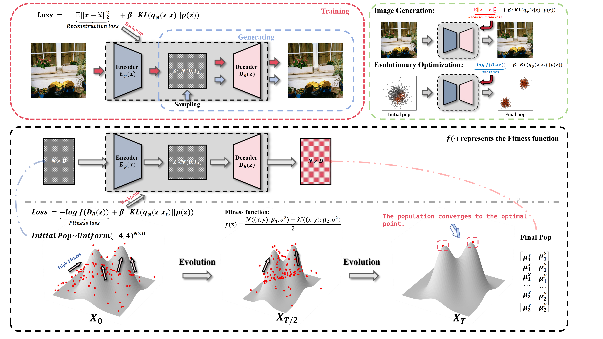
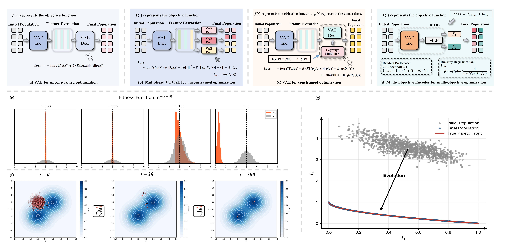

## Can Evolution Be Learned as a Generative Process?
### Elite-Population Learning for Black-Box Generative Optimization

[](https://opensource.org/licenses/MIT)
[](https://www.python.org/)

**VAE Evolution** - Official PyTorch Implementation
> 📄 **Paper Status**: A manuscript describing this work is in preparation and will be submitted soon.We will update this page with a link to the paper upon submission or publication.

> *Learning to generate high-quality solution populations from online elite selection*

## Introduction
VAE Evolution learns generative models from elite solution populations collected during black-box optimization. The objective function evaluates candidate solutions; selection and archive maintenance turn these evaluations into training data. The model learns to reconstruct and generate high-quality solutions, and its updated decoder supplies candidates for subsequent search iterations.

The central learning signal is the evolving elite population. There is no fixed external training dataset: the search and learning stages repeatedly update one another. Single-objective variants use objective ranking and rank-weighted learning; PVAE uses nondominated archives and coverage-oriented Pareto anchors.

## Core Methodology

1. **Generate candidates.** Combine decoder samples with global exploration and variant-specific search operations, such as prototype or elite mutations.
2. **Evaluate and select.** Query the black-box objective on detached candidates. Retain high-quality solutions through scalar-objective ranking or Pareto selection, and maintain an archive across iterations.
3. **Learn from elites.** Update the neural model using reconstruction, latent regularization, prototype supervision, or Pareto-set coverage losses, depending on the variant.
4. **Repeat and calibrate.** Use the updated generator in the next search iteration. VQ variants calibrate their codebook outputs and encoder routing; PVAE refines Pareto anchors and distils them into its conditional decoder.
5. **Evaluate fresh generations.** Sample independently from the trained decoder and measure population quality, diversity, or Pareto-front approximation.

**Gradient handling.** Objective evaluation and elite selection do not backpropagate through the objective function. Neural-network parameters are trained by backpropagation through the model losses. The implementation also includes configurable zero-order refinement: extra black-box queries estimate local directions by finite differences. These estimates do not require analytical or autograd gradients of the objective. PVAE additionally uses black-box coordinate/group search and objective-matching finite differences during continuous-task distillation.

The implementation therefore centers on elite-population learning, with search and calibration mechanisms supporting generation quality. It does not explicitly construct or fit a normalized target density from a transformation of objective values. Quality scores used for reporting are distinct from the main training losses.



## Model Variants

The four variants share online elite selection but use different representations and supervision to match the desired solution population.

| Variant | Representation and training | Intended role |
| --- | --- | --- |
| **VAE (`IVAE`)** | Continuous Gaussian latent variables; rank-weighted elite reconstruction and KL regularization, with configurable zero-order refinement. | Concentrate generation around high-quality regions in single-objective optimization. |
| **VQVAE** | Discrete codebook; rank-weighted reconstruction, codebook/commitment losses, elite prototype targets, and final calibration. | Represent multiple high-quality solution prototypes; grid-based archive selection supports spatial diversity. |
| **MH-VQVAE (`MHVQVAE`)** | Shared encoder and codebook with multiple decoder heads; best-head reconstruction, separated elite targets, and per-head calibration. | Assign different heads to distinct solution modes in multi-peak optimization. |
| **PVAE** | Preference-conditioned encoder and decoder; Pareto archives, conditional reconstruction, KL regularization, symmetric set coverage, and refined-anchor distillation. | Generate solutions spanning different trade-offs in multi-objective optimization, with support for disconnected and binary solution sets. |

The model architectures, elite selection, local search, and calibration together define the implemented methods. Their individual contributions require ablation experiments; architectural changes alone do not establish the source of performance gains.



## Evaluation: Generated Population Quality

The evaluation target is the quality and distribution of independently generated solutions. An archive's best objective value alone does not establish that the trained generator produces a good population. `scripts/eval.py` samples Gaussian latents for IVAE, effective codebook entries for VQ variants, and latents plus preferences for PVAE. Normal PVAE evaluation uses the neural decoder; stored-anchor interpolation is reserved for explicit ablation.

For single-objective tasks, the evaluator reports:

- **Quality (`fitness_reward`):** the mean score `1 / (1 + abs(f(x) - target) / scale + epsilon)`, where `target` and `scale` are configured for each benchmark. A higher score means generated objective values are closer to the reference target. This score is derived from objective evaluations, rather than independent of them.
- **Diversity (`entropy`):** entropy of occupied decision-space grid cells. Interpret it alongside quality; a dispersed population need not contain good solutions.
- **Auxiliary raw values (`average_fitness`):** mean objective values remain available for interpretation and reproducibility, alongside the quality and diversity metrics.

Metrics are reported for the full generated population and its selected Top-k subset. Multi-head evaluation selects a share of Top-k from each head. There is no combined quality-diversity score in the current evaluator.

For multi-objective tasks, **GD**, **IGD**, and **SP (Spacing)** measure proximity to a reference front, reference-front coverage, and spacing regularity, respectively. They are computed in objective space from the independently generated population; the training-time Chamfer set loss is computed in decision space. Spacing should be interpreted together with GD and IGD.

Report objective-query costs, neural update counts, and calibration costs separately when comparing methods. Search iterations alone do not capture the cost of finite differences, local search, and coverage exploration.


## Installation

### Using pip
```bash
pip install -r requirements.txt
```


## Quick Start
```python
import torch
from model.VAEs import MHVQVAE
from scripts.train import train_MHVQVAE
from scripts.eval import generate_decoder_samples
from probfun.fitness import himmelblau as fitness_function

input_dim = 2
batch_size = 512
epochs = 30
learning_rate = 0.001
num_embeddings = 32
embedding_dim = 16


model = MHVQVAE(input_dim, num_embeddings, embedding_dim, n_heads=4,
                use_tanh=True, tanh_scale=5.0)


model , loss_trace = train_MHVQVAE(model=model, device="cpu", input_dim=input_dim, batch_size=batch_size, fitness_function=fitness_function,
                           epochs=epochs,learning_rate =learning_rate,
                           objective="minimize",
                           )


x0_pred = generate_decoder_samples(model, sample_count=10000, device="cpu")


print(x0_pred[1])

print(x0_pred[0])
```

## Project Structure
```
vae_evo/
├── examples/     # Usage examples
├── model/        # Model definitions
├── probfun/      # Probability functions
├── scripts/      # Elite learning, model training, and generation evaluation
├── experiment/   # Benchmark entry points and results
└── requirements.txt
```


## 📄 License

This project is licensed under the MIT License - see the [LICENSE](LICENSE) file for details.

## ➕Citation

Coming soon! Please star/watch this repository to stay updated.
